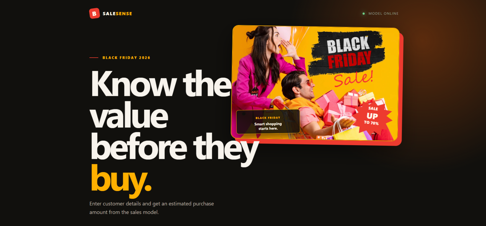

# Black Friday Sales Prediction Analysis

This project analyzes customer purchase behavior and predicts `Purchase` for
the standard Black Friday dataset.



## Run

1. Install dependencies:

   ```text
   python -m pip install -r requirements.txt
   ```

2. Run a smoke test without external data:

   ```text
   python black_friday_analysis.py --synthetic
   ```

3. Run against the Kaggle-style file:

   ```text
   python black_friday_analysis.py --input data/train.csv
   ```

4. Start the interactive frontend:

   ```text
   streamlit run app.py
   ```

   The browser app starts in demo mode with synthetic data. Upload the
   Kaggle-style `train.csv` in the sidebar to train on real data, then enter
   customer details and click **Predict purchase amount**.

5. Start the standalone HTML/CSS/JavaScript frontend:

   ```text
   python web_server.py
   ```

   Open `http://127.0.0.1:8000`. The browser frontend calls the local JSON
   prediction API and uses the same model preprocessing as the analysis.

The input must contain a `Purchase` column. `User_ID` and `Product_ID` are
excluded from modeling because they are identifiers. By default, at most
100,000 rows are used; pass `--max-rows 0` to use the complete file.

## Outputs

The `outputs/` directory contains:

- `metrics.json`: MAE, RMSE, and R² on a reproducible 20% holdout set.
- `predictions.csv`: actual and predicted purchase amounts.
- `data_summary.csv`: descriptive statistics.
- `average_purchase_by_age.png`: exploratory age-group comparison.
- `actual_vs_predicted.png`: model diagnostic plot.

The model uses median imputation for numeric fields, most-frequent imputation
and one-hot encoding for categorical fields, followed by a random forest
regressor. Metrics are directional and should be rechecked with a time-aware
or customer-aware validation strategy before production use.

## Forecasting workspace

The browser workspace also documents and demonstrates the complete sales
forecasting workflow:

- Hypothesis generation for product-level and store/customer-level drivers.
- Data exploration using transaction counts, average purchase, demographics,
  and city segments.
- Preprocessing with missing-value handling, identifier removal, and
  categorical one-hot encoding.
- An 80/20 train-test split for generalization checks.
- Comparison of Linear Regression, Decision Tree, Random Forest, Extra Trees,
  and Gradient Boosting regressors using RMSE and R².
- Random Forest feature-importance inspection and Matplotlib visual analysis.

The default browser report uses the bundled synthetic data so it is runnable
without external files. For meaningful supply, inventory, and marketing
decisions, place the Kaggle Black Friday `train.csv` at `data/train.csv` and
run the analysis command with `--max-rows 0`. The synthetic dataset is only a
workflow demonstration and must not be used for business planning.
